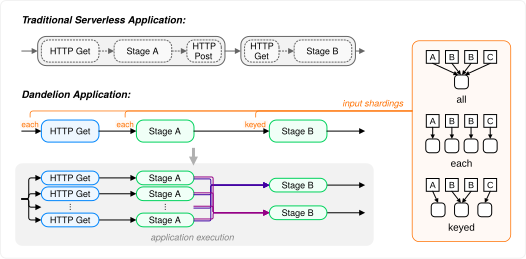

# Dandelion Composition

In Dandelion an application is built by chaining together system provided communication functions 
and user defined pure compute functions. Compositions describe the dataflow between the functions 
of an application.

<div align="center">
  <picture>
    
  </picture>
</div>
<br>

# Core Components

## Sets and Items
Each function has zero or more input and output sets. Each set contains an arbitrary number of 
unordered items.

Items carry a string identifier and an integer key. Keys are used to group items within a set and 
further allow multiple input sets to be joined. Identifiers may be used to identify specific items 
in a set.

## Function declarations
Function declarations declare functions used in the compositions. A function needs to be declared 
before it may be called in a composition. The declaration must match the registered function in the 
system.

A function declaration starts with the `function` keyword followed by the name of the function, a 
comma separated list of input set names in parenthesis, a `=>`, and a comma separated list of output 
set names in parenthesis.
For example the system function for HTTP requests can be declared as:
```
function HTTP (requests) => (headers, bodies);
```

The names of the sets in the function declaration need to match the names that are used when the 
function is registered. The order matters, i.e. the first set name will be the set with index 0 in 
the function implementation.

## Function applications
A function application inside a composition declaration defines how a declared function is run, 
i.e. what input set gets what data and how data is distributed among potentially multiple 
invocations of that function.

A function application starts with the name of the function followed by a comma separated list of 
input set assignments in parenthesis, a `=>`, the comma separated output set assignments in 
parentheses, and a `;`. In addition, a [join strategy](#join-strategy) may be attached after the output sets (see more 
under data parallelization).
```
<function-name> (<input-set-application>, ...) => (<output-set-application>, ...) [by <join-strategy>];
```

An input set assignment defines how an input set gets its data in the composition. It starts with 
the set name followed by a `=`, an optional `optional` keyword, a [sharding keyword](#shardings), and the 
composition set name.

> NOTE:
> By default a function application is not run if one of its input sets is empty, unless that input set is defined as an optional input set using the `optional` keyword.

```
<function-input-set-name> = [optional] <sharding> <composition-set-name>
```

An output set assignment defines which output set becomes which composition set. It starts with the 
composition set name followed by a `=` and the output set name.
```
<composition-set-name> = <function-output-set-name>
```

The (optional) join strategy starts with a `by` keyword followed by the first input set name, the 
join type, and the second input set name. To join more than two sets the join type and set name of 
the next input set is added after the previous input set.
```
by <input-set-name> <inner/left/right/full/cross> <input-set-name> [<inner/left/right/full/cross> <input-set-name> ...]
```

Putting it all together an example of a function application looks as follows:
```
compress (pics = keyed classified, archives = keyed fetched_archives) => 
        (store_requests = put_requests) by pics left archives;
```

## Composition declarations
Compositions have the same signature as a function allowing other compositions to use them as 
if they were user defined compute functions. As for function declarations, a composition to be used 
in another one needs to be defined before the calling one.

The composition declaration follows the function declaration. Instead of the `function` keyword the 
`composition` keyword is used. Next come the name of the composition, the input sets, the `=>`, the 
output sets, and finally the composition body surrounded by curly braces. The body contains a list of function applications.


# Data Parallel Execution

There are two parts defining data parallel execution. Shardings define how the items of an input 
set are distributed among multiple invocations. Join strategies allow to further specify how 
multiple input sets interact with each other.

### Shardings
Each set can be parallelized in the following ways. The `any`-prefixed shardings allow Dandelion to 
group invocations if a function can deal with this (e.g. process multiple groups in one execution) 
while the other shardings do not.

| Keyword | Parallelism | Allow Grouping | Description |
|-|-|-|-|
| `all` | no | no | all items are given to the same invocation |
| `each` | full | no | each item is given to a separate invocation |
| `keyed` | grouped | no | items are grouped based on their key, each group is given to a separate invocation |
| `anyEach` | full | yes | each item is given to a separate invocation |
| `anyKeyed` | grouped | yes | items are grouped based on their key, each group is given to a separate invocation |

### Join Strategy

If a function has multiple input sets, each is parallelized based on its sharding and the cross product of invocations is spawned. Specifying a user defined join strategy changes this. 

Join strategies may only be applied to `keyed` and `anyKeyed` sets, and a single join chain cannot mix `keyed` with `anyKeyed` sets. The following join types are supported:

| Keyword | Description |
|-|-|
| `inner` | create a function invocation only for keys present in both sets |
| `left` | create a function invocation for each key in the left set, adding items from the set on the right if they have the same key |
| `right` | create a function invocation for each key in the right set, adding items from the left set if they have the same key |
| `full` | create a function invocation for each key in either set, a function gets all items with the same key from any of the two sets |
| `cross` | create a function invocation for each combination of one key from left set with one key from right set |

*Where `cross` describes the default behaviour*

# Example
The following example composition uses the `HTTP` system function and two user defined functions. 
`classify` tags each picture with a key, outputting the pictures with the associated keys as well 
as a list of HTTP GET requests to fetch existing archives containing pictures with the same keys. 
`compress` reads the HTTP response, if there is an archive for the key of the pictures to compress, 
adds all pictures into that archive and otherwise compresses them into a new one. Then it creates 
an HTTP PUT request to upload the updated/new archive to storage.

```
function classify (pics) => (tagged_pics, archives);
function compress (pics, archives) => (put_requests);
function HTTP (requests) => (headers, bodies);

composition image_process (images) => (status) {
    classify (pics = all images) => 
        (classified = tagged_pics, fetch_requests = archives);
    
    HTTP (requests = each fetch_requests) =>
        (fetched_archives = bodies);
    
    compress (pics = keyed classified, archives = keyed fetched_archives) => 
        (store_requests = put_requests) by pics left archives;
    
    HTTP (requests = each store_requests) =>
        (status = headers);
}
```

# Checking Compositions

The `dparser` binary checks whether a composition parses. It reads the composition from the file 
given as argument, or from stdin if no file is given:
```
cargo run -p composition --bin dparser -- composition/example_input.txt
```

> NOTE:
> Function declarations are not checked against registered functions, only whether the composition itself is valid.
